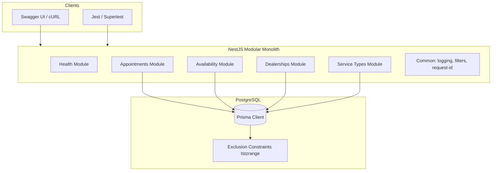
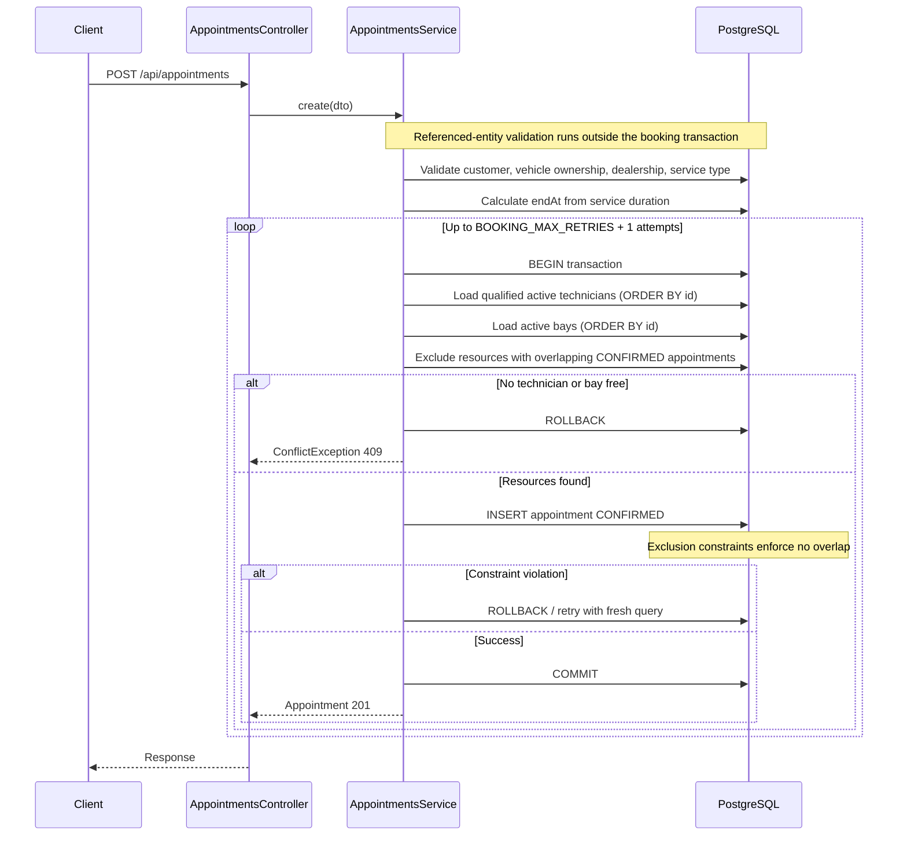
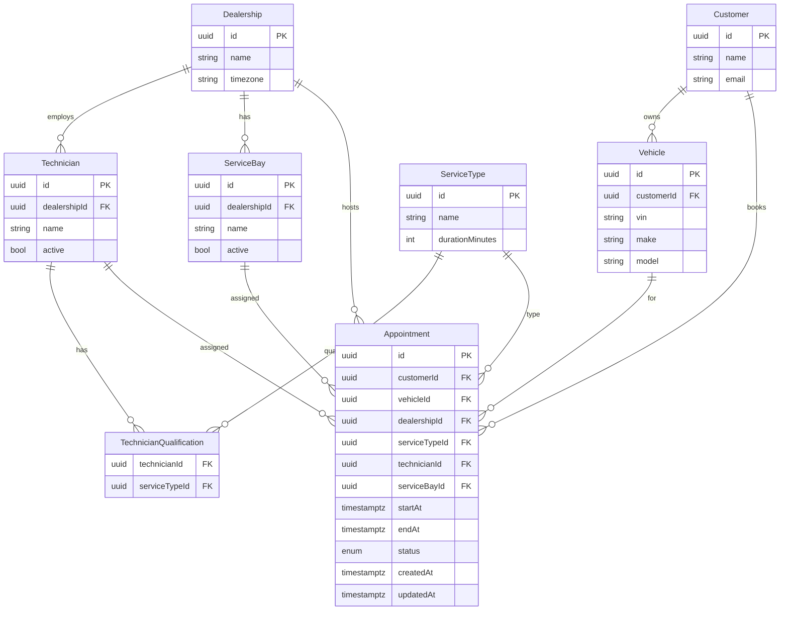
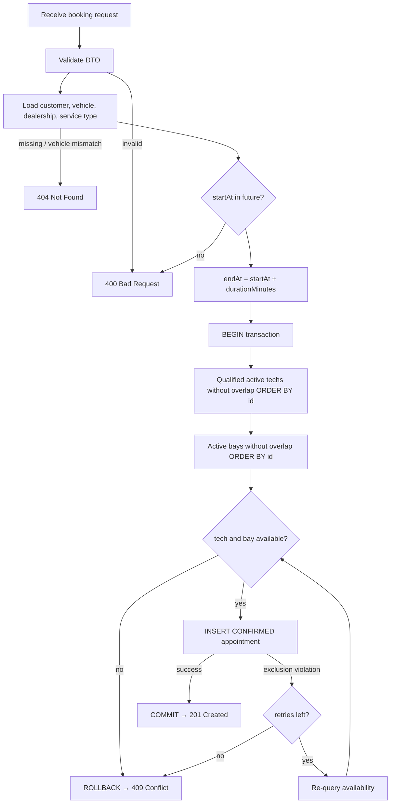

# System Design — Keyloop Unified Service Scheduler

## 1. Problem Statement

Replace manual dealership booking with a REST API that atomically assigns a **qualified technician** and an **active service bay** for a requested slot, persisting a confirmed appointment without double-booking under concurrency.

## 2. Architecture Overview

Modular NestJS monolith: Controller → Application Service → Persistence (Prisma + raw SQL where required).

### Components

| Component | Responsibility |
| --- | --- |
| Controllers | HTTP mapping, DTO validation, status codes |
| Application services | Booking orchestration, eligibility, conflict mapping |
| Repositories | Queries and transactional writes via Prisma |
| Domain helpers | Duration, interval overlap, eligibility (pure TS, unit-tested) |
| Prisma module | Connection lifecycle |
| Common | Pino logging, request ID, exception filter |
| PostgreSQL | Source of truth + exclusion constraints |

## 3. Booking Sequence

## 4. Entity Relationship Model

## 5. Booking Decision / Transaction Flow

## 6. Business Rules

1. Validate request body (UUIDs, ISO datetime with offset).
2. Customer, vehicle, dealership, service type must exist.
3. Vehicle must belong to customer.
4. `startAt` must be in the future.
5. `endAt = startAt + serviceType.durationMinutes`.
6. Technician: same dealership, `active`, qualified for service type, no overlapping CONFIRMED appointment on `[startAt, endAt)`.
7. Service bay: same dealership, `active`, no overlapping CONFIRMED appointment.
8. Allocate first free technician and bay by ascending `id`.
9. Persist `CONFIRMED` appointment atomically.
10. Half-open overlap: intervals overlap iff `startA < endB AND startB < endA`.

## 7. API Contracts

| Method | Path | Purpose |
| --- | --- | --- |
| GET | `/api/health` | Liveness |
| GET | `/api/dealerships` | List dealerships |
| GET | `/api/service-types` | List service types |
| GET | `/api/availability` | Advisory availability counts |
| POST | `/api/appointments` | Create booking (201) |
| GET | `/api/appointments/:id` | Fetch appointment |

### Error mapping

| Condition | HTTP |
| --- | --- |
| Validation failure (incl. missing offset, impossible calendar date) | 400 |
| Past `startAt` on booking or availability | 400 |
| Missing entity / vehicle not owned by customer | 404 |
| No resources / exclusion conflict after retries | 409 |
| Unexpected failure (generic message only) | 500 |

Availability is **never** a lock or reservation.

## 8. Concurrency & Consistency Strategy

**Problem:** Check-then-insert races allow double booking.

**Solution (defense in depth):**

1. **Application:** Transaction wraps re-check + insert. Deterministic ordering. On unique/exclusion conflict (`23P01`), bounded retry (max 3) with fresh resource selection.
2. **Database:** Partial exclusion constraints on `appointments` for `status = 'CONFIRMED'`:
   - `EXCLUDE USING gist (technician_id WITH =, tstzrange(start_at, end_at, '[)') WITH &&)`
   - Same for `service_bay_id`.
3. Extension: `btree_gist` for equality + range in GiST.

**Isolation:** Default `READ COMMITTED` is used. Overlapping resource use is prevented by exclusion constraints at the storage layer; the application retries the whole booking transaction on recognized transient conflicts (exclusion violations, PostgreSQL deadlock/serialization SQLSTATEs, and Prisma `P2034` write conflicts/deadlocks), re-querying resources each time.

**Why exclusion constraints (not SERIALIZABLE alone)?** Exclusion constraints enforce the specific no-overlap invariant for technician and bay directly, even under `READ COMMITTED`, and are simple to verify in SQL and tests. PostgreSQL `SERIALIZABLE` with correct predicate queries and retry-on-serialization-failure can also prevent anomalies, but it has different operational trade-offs (more serialization retries, harder-to-explain failure modes). This design keeps `READ COMMITTED` + exclusions as the primary invariant.

## 9. Technology Decisions

| Choice | Rationale |
| --- | --- |
| NestJS + TS strict | Chosen for this implementation; modular DI fits Controllers/Services |
| PostgreSQL + Prisma | Chosen for this implementation; Prisma for CRUD; SQL migration for exclusions (Prisma cannot model them natively) |
| Testcontainers | Real Postgres for concurrency proof |
| Pino | Structured JSON logs with Nest integration |
| Docker Compose | Reproducible local Postgres + API |
| pnpm | Chosen for this implementation |

## 10. Observability

**Implemented:**

- Structured JSON logs (Pino)
- `X-Request-Id` generation/propagation
- HTTP method, path, status, duration
- Booking outcome logs (success/conflict) without email/VIN dump
- Sanitized DB error logging (code + message, no params dump of PII)
- `GET /api/health`

**Suggested production metrics (not wired):**

- `http_request_duration_seconds` histogram
- `booking_success_total` / `booking_conflict_total` / `booking_retry_total`
- DB connection pool saturation
- Alert on conflict rate spikes and p99 latency
- Future: OpenTelemetry traces spanning HTTP → Prisma spans

## 11. GenAI Usage in Design

AI assisted drafting of this document structure, Mermaid diagrams, and alternative concurrency patterns. Human decisions locked:

- Exclusion constraints as source of truth (not advisory locks alone)
- Half-open intervals and deterministic UUID ordering
- No operating hours (assumption)
- Keep modular monolith; reject Redis/Kafka as unnecessary complexity for Scenario A

See [AI_COLLABORATION.md](./AI_COLLABORATION.md) for verification narrative.

## 12. Operational Considerations

- Migrations applied explicitly (`prisma migrate deploy`)
- Seed data for demo IDs documented in README
- Single-instance API is fine for assessment; horizontal scale is safe for booking because invariants live in Postgres
- Connection pool size should stay below Postgres `max_connections`

## 13. Data integrity (database vs application)

| Invariant | Enforcement |
| --- | --- |
| No overlapping CONFIRMED tech/bay bookings | PostgreSQL exclusion constraints |
| `end_at > start_at` | PostgreSQL CHECK |
| `duration_minutes > 0` | PostgreSQL CHECK |
| Vehicle belongs to customer | Application booking validation |
| Tech/bay belong to appointment dealership | Application dealership-scoped queries |

## 14. Out of Scope

See [ASSUMPTIONS.md](./ASSUMPTIONS.md) A13. Microservices and message buses are intentionally avoided as overengineering for Scenario A, not because Keyloop forbids them by name.
